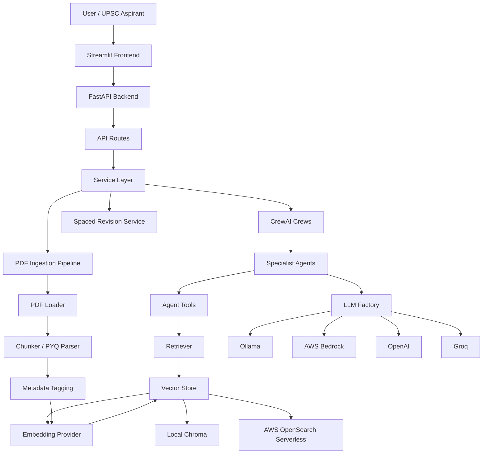
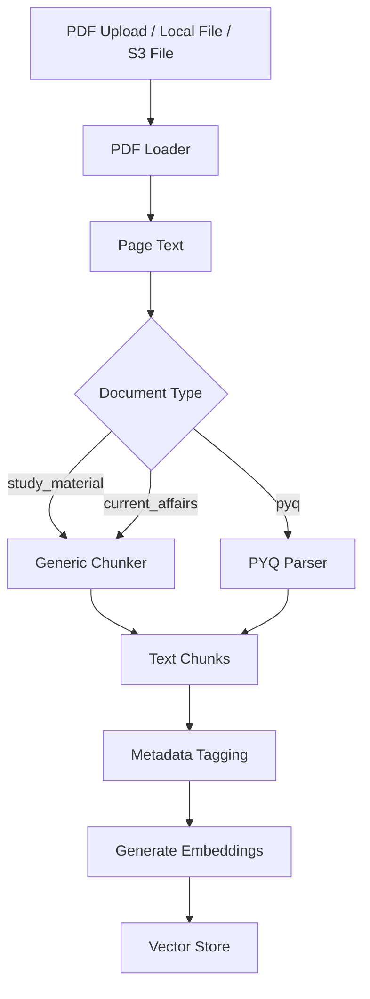
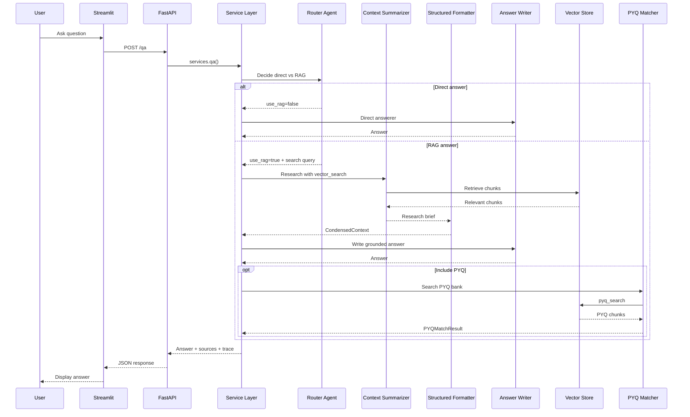
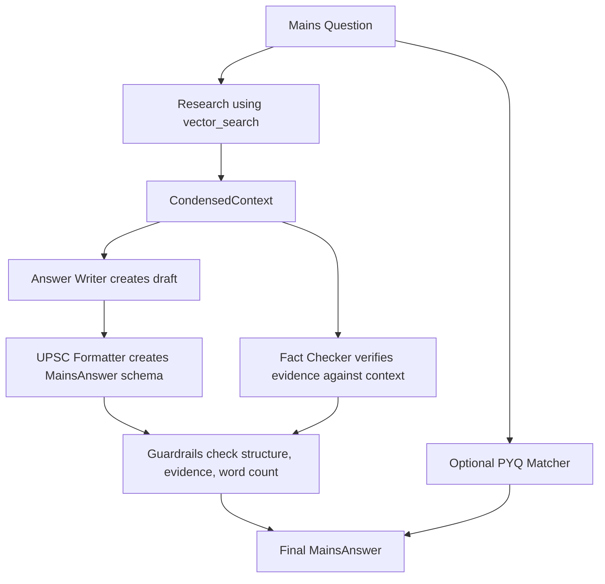

# UPSC Sarathi Agentic - Full Project Guide

This document explains the complete project architecture, data flow, modules, features, setup process, and important design decisions for the UPSC Sarathi Agentic project.

The project is an agentic RAG based UPSC Civil Services preparation assistant. It combines:

- A FastAPI backend for all API endpoints.
- A Streamlit frontend for the user interface.
- CrewAI agents for reasoning, writing, evaluation, question generation, syllabus mapping, and PYQ matching.
- A vector database for retrieval augmented generation.
- PDF ingestion pipelines for study material, current affairs, and previous year questions.
- Local and AWS deployment profiles.
- A spaced repetition scheduler for revision.

---

## 1. Project Purpose

UPSC aspirants need help with many different activities:

- Asking concept or current-affairs questions.
- Getting answers grounded in uploaded study material.
- Writing model mains answers.
- Writing essays.
- Generating prelims MCQs.
- Generating mains questions.
- Preparing topper-style notes.
- Matching a topic with previous year questions.
- Evaluating mains answers and essays.
- Mapping topics to the UPSC syllabus.
- Revising facts using spaced repetition.

This project builds one assistant that supports all of those workflows.

The important idea is that the assistant is not only a simple chatbot. It uses specialist agents, retrieval from uploaded PDFs, structured output schemas, and guardrails to make the outputs more UPSC-oriented and more reliable.

---

## 2. High-Level Architecture



The application is organized into clear layers:

1. Frontend layer: Streamlit user interface.
2. API layer: FastAPI routes.
3. Service layer: Plain Python orchestration functions.
4. Agent layer: CrewAI agents and task pipelines.
5. Retrieval layer: Embeddings, vector store, and retriever.
6. Ingestion layer: PDF loading, chunking, tagging, and storing.
7. Infrastructure layer: Terraform and deployment scripts.

---

## 3. Main Technology Stack

| Area | Technology |
| --- | --- |
| Backend API | FastAPI |
| Frontend | Streamlit |
| Agent orchestration | CrewAI |
| Data validation | Pydantic |
| Vector database, local | Chroma |
| Vector database, AWS | OpenSearch Serverless |
| Embeddings | Ollama, Bedrock, Sentence Transformers, OpenAI |
| LLM providers | Ollama, Bedrock, OpenAI, Groq |
| PDF loading | pdfplumber, pypdf, unstructured, AWS Textract |
| Deployment | AWS ECS Fargate, ALB, ECR, S3, DynamoDB, Terraform |
| Testing | Pytest |
| Revision algorithm | SM-2 spaced repetition |

---

## 4. Folder Structure

```text
Group_10_code - Copy/
  app/
    api/
      routes/
        api.py
    agents/
      agents.py
      guardrails.py
      llm_factory.py
      tools.py
      crews/
        qa_crew.py
        mains_answer_crew.py
        essay_crew.py
        question_gen_crew.py
        notes_crew.py
        evaluator_crew.py
        pyq_matcher_crew.py
        digest_crew.py
        syllabus_crew.py
    core/
      embeddings.py
      retrieval.py
      vectorstore.py
    ingestion/
      chunker.py
      pdf_loader.py
      pipeline.py
      pyq_parser.py
    models/
      schemas.py
      agent_schemas.py
    services/
      services.py
      revision.py
      trace.py
    utils/
      word_count.py
    config.py
    main.py

  frontend/
    streamlit_app.py

  infrastructure/
    main.tf

  scripts/
    setup_local.sh
    ingest_docs.sh
    pull_ollama_models.sh
    deploy_aws.sh
    teardown.sh

  tests/
    test_smoke.py

  requirements.txt
  .env.example
```

---

## 5. Runtime Profiles

The same codebase supports different deployment profiles using environment variables.

### 5.1 Local Profile

Default local setup:

- LLM provider: Ollama
- Embeddings provider: Ollama
- Vector store: Chroma
- PDF loader: pdfplumber
- Persistence: local `./data/chroma`

Typical local environment:

```text
APP_MODE=local
VECTOR_STORE=chroma
LLM_PROVIDER=ollama
EMBEDDINGS_PROVIDER=ollama
OLLAMA_MODEL=llama3.1:8b
OLLAMA_MODEL_FAST=llama3.2:3b
OLLAMA_EMBED_MODEL=nomic-embed-text
```

This is best for development and demos on a local machine.

### 5.2 AWS Profile

AWS setup:

- LLM provider: AWS Bedrock
- Embeddings provider: AWS Bedrock
- Vector store: OpenSearch Serverless
- PDF OCR option: AWS Textract
- Document storage: S3
- Progress tracking: DynamoDB
- Hosting: ECS Fargate behind an Application Load Balancer

Typical AWS environment:

```text
APP_MODE=aws
VECTOR_STORE=opensearch
LLM_PROVIDER=bedrock
EMBEDDINGS_PROVIDER=bedrock
USE_TEXTRACT=true
ENABLE_PROGRESS_TRACKING=true
```

This is intended for cloud deployment.

### 5.3 OpenAI and Groq Options

The code also supports OpenAI and Groq for LLM calls.

Groq is handled as an OpenAI-compatible endpoint in `app/agents/llm_factory.py`. Because Groq does not provide embeddings, the project expects another embeddings provider such as Sentence Transformers.

---

## 6. Application Startup Flow

The FastAPI app starts from:

```text
app/main.py
```

Startup sequence:

1. Load settings from `.env` through `app/config.py`.
2. Configure logging with Loguru.
3. Create the FastAPI app.
4. Add CORS middleware.
5. Mount all API routes under `/api/v1`.
6. Expose a root endpoint at `/`.

Important app routes:

```text
GET  /
GET  /api/v1/health
GET  /api/v1/stats
POST /api/v1/qa
POST /api/v1/mains/write
POST /api/v1/essay/write
POST /api/v1/generate/mcq
POST /api/v1/generate/mains
POST /api/v1/generate/notes
POST /api/v1/test/prelims
POST /api/v1/test/mains
POST /api/v1/evaluate
POST /api/v1/evaluate/essay
POST /api/v1/pyq/match
POST /api/v1/syllabus/map
POST /api/v1/ingest/upload
POST /api/v1/ingest/pyq
POST /api/v1/ingest/current-affairs
POST /api/v1/sr/add
POST /api/v1/sr/review
GET  /api/v1/sr/due
```

---

## 7. Backend Layer Explanation

### 7.1 `app/config.py`

This file defines one central `Settings` object using Pydantic Settings.

It controls:

- App mode.
- AWS region and credentials.
- S3 settings.
- Vector store settings.
- LLM provider and model names.
- Embeddings provider and model names.
- Chunk size and overlap.
- PDF loader.
- Agent flags.
- Answer-writing standards.
- API ports.
- DynamoDB progress tracking.

Important design point:

The code avoids hardcoding `if local else aws` logic everywhere. Most modules simply read from `settings`. That makes the project switchable by changing `.env` values.

### 7.2 `app/main.py`

This is the FastAPI entry point.

It:

- Builds the FastAPI app.
- Registers middleware.
- Includes the API router.
- Returns app metadata at `/`.

### 7.3 `app/api/routes/api.py`

This file contains all HTTP endpoints.

The routes are intentionally thin. They:

1. Receive and validate requests.
2. Call a function in `app/services/services.py`.
3. Convert the result into the correct API response.
4. Handle errors by returning HTTP 500 or specific status codes.

Example:

```text
POST /api/v1/qa
  -> services.qa(...)
  -> QAResponse
```

### 7.4 `app/services/services.py`

This is the orchestration layer between API routes and agent crews.

It is important because it keeps FastAPI-specific logic out of the agent code.

For example:

- `qa()` calls the QA crew.
- `mains_write()` calls the mains answer crew.
- `essay_write()` calls the essay crew.
- `generate_mcq()` calls the question generation crew.
- `ingest_study_material()` calls the ingestion pipeline.
- `ingest_current_affairs()` ingests PDFs and optionally creates digests.

The service layer returns plain dictionaries so it can be reused by:

- FastAPI routes.
- Streamlit frontend.
- Tests.
- Future CLI scripts.

---

## 8. Data Models

There are two model files:

```text
app/models/schemas.py
app/models/agent_schemas.py
```

### 8.1 API Schemas

`app/models/schemas.py` defines request and response models for the HTTP API.

Examples:

- `QARequest`
- `MCQRequest`
- `MainsWriteRequest`
- `EssayWriteRequest`
- `AnswerEvalRequest`
- `PYQMatchRequest`
- `SRAddRequest`
- `SRReviewRequest`
- `QAResponse`
- `Source`

These are user-facing API contracts.

### 8.2 Agent Schemas

`app/models/agent_schemas.py` defines structured outputs produced by CrewAI agents.

Important schemas:

- `RouteDecision`
- `CondensedContext`
- `MainsAnswer`
- `BodyPoint`
- `EssayAnswer`
- `MCQBatch`
- `MainsQuestionBatch`
- `NotesOutput`
- `MainsEvaluation`
- `EssayEvaluation`
- `PYQMatchResult`
- `SyllabusMap`
- `DigestOutput`
- `VerificationResult`

This is a key strength of the project. Instead of asking the LLM to produce loose markdown, the project asks agents to produce structured Pydantic objects. That makes outputs easier to validate, render, and guardrail.

---

## 9. Agent Architecture

Agents are defined in:

```text
app/agents/agents.py
```

The project uses many narrow specialist agents instead of one large general agent.

| Agent | Purpose |
| --- | --- |
| Router Agent | Decides whether a question needs RAG or can be answered directly. |
| Direct Answerer | Answers general non-RAG questions. |
| Structured Output Formatter | Converts research briefs into Pydantic schemas. |
| Context Summarizer | Searches vector DB and condenses retrieved context. |
| Answer Writer | Writes source-grounded explanatory answers. |
| UPSC Formatter | Converts draft answers into strict UPSC mains format. |
| Essay Architect | Researches and writes multidimensional essays. |
| MCQ Setter | Creates prelims-style MCQs. |
| Mains Question Setter | Creates mains questions and model outlines. |
| Notes Writer | Generates topper-style notes. |
| Mains Evaluator | Scores mains answers out of 15. |
| Essay Evaluator | Scores essays out of 125. |
| PYQ Matcher | Searches previous year questions and identifies patterns. |
| Digest Curator | Summarizes current-affairs PDFs into compact digests. |
| Syllabus Mapper | Maps text or topics to UPSC syllabus areas. |
| Fact Checker | Verifies evidence claims against retrieved source context. |

### 9.1 Why Agents Are Cached

The factory functions in `agents.py` use `@lru_cache`.

Reason:

- Agents are mostly configuration objects.
- They can be reused safely.
- CrewAI tasks and crew outputs hold per-request state, so those are created fresh for each request.

### 9.2 Why Delegation Is Disabled

Every agent has:

```python
allow_delegation=False
```

This keeps execution predictable. Instead of allowing agents to call other agents freely, the Python crew files explicitly define the order of tasks.

This is easier to debug, easier to explain, and better for controlling cost and latency.

---

## 10. LLM Factory

LLMs are created in:

```text
app/agents/llm_factory.py
```

The project asks for an LLM by tier:

```text
fast
smart
long
```

The actual model depends on `LLM_PROVIDER`.

| Tier | Used For | Typical Model |
| --- | --- | --- |
| fast | Routing, PYQ matching, syllabus mapping, fact checks | Smaller/faster model |
| smart | Writing, planning, evaluation, formatting | Stronger model |
| long | Essay writing | Same smart model with bigger token budget |

This design lets the project switch providers without changing the agent code.

Example:

```python
llm=get_llm("smart")
```

The agent does not need to know whether the smart model comes from Ollama, Bedrock, OpenAI, or Groq.

---

## 11. Retrieval and Vector Store Architecture

Retrieval code lives in:

```text
app/core/embeddings.py
app/core/vectorstore.py
app/core/retrieval.py
```

### 11.1 Embeddings

`app/core/embeddings.py` supports:

- Bedrock embeddings.
- Ollama embeddings.
- Sentence Transformers embeddings.
- OpenAI embeddings.

Embeddings convert text into vectors so semantically similar text can be searched.

### 11.2 Vector Store

`app/core/vectorstore.py` defines one common interface:

```python
add(texts, metadatas)
similarity_search(query, k, filter)
count()
delete_by_source(source)
```

Two implementations exist:

- `ChromaStore` for local use.
- `OpenSearchStore` for AWS use.

The rest of the code does not need to know which store is active. It calls `get_vector_store()`.

### 11.3 Retriever

`app/core/retrieval.py` wraps vector search and adds MMR reranking.

MMR means Maximal Marginal Relevance.

Purpose:

- Retrieve chunks that are relevant.
- Avoid returning many near-duplicate chunks.
- Give the agents a more diverse context.

Retriever flow:

```text
query
  -> vector similarity search
  -> candidate chunks
  -> optional MMR rerank
  -> top k chunks
  -> formatted context string
```

---

## 12. Agent Tools

Agent tools are defined in:

```text
app/agents/tools.py
```

There are two CrewAI tools:

### 12.1 `VectorSearchTool`

Used to search the ingested UPSC vector database.

It can optionally filter by:

- Subject.
- Document type.

Document types include:

```text
study_material
pyq
current_affairs
digest
```

### 12.2 `PYQSearchTool`

Searches only documents tagged as:

```text
doc_type = pyq
```

This is used by the PYQ matcher agent.

---

## 13. Ingestion Architecture

Ingestion code lives in:

```text
app/ingestion/pdf_loader.py
app/ingestion/chunker.py
app/ingestion/pyq_parser.py
app/ingestion/pipeline.py
```

### 13.1 Ingestion Data Flow



### 13.2 PDF Loading

`pdf_loader.py` supports:

- `pdfplumber`: default, good balance of layout and table handling.
- `pypdf`: faster, basic text extraction.
- `unstructured`: heavier but useful for difficult layouts.
- `textract`: AWS OCR for scanned PDFs.

### 13.3 Generic Chunking

`chunker.py` uses `RecursiveCharacterTextSplitter` with UPSC-specific separators:

- Chapter markers.
- Section markers.
- Article markers.
- Paragraphs.
- Sentences.
- Words.

Chunk size and overlap are controlled by:

```text
CHUNK_SIZE=1000
CHUNK_OVERLAP=150
```

### 13.4 PYQ Chunking

Previous year question PDFs are different from books or notes. They are usually lists of numbered questions.

`pyq_parser.py` tries to split each page into separate question chunks using patterns like:

```text
1.
Q.1
1)
```

It also extracts metadata from filenames where possible.

Good filenames:

```text
Prelims_GS1_2023.pdf
Mains_GS2_2021.pdf
UPSC_Prelims_2019.pdf
```

Extracted metadata:

- Exam year.
- Exam type.
- GS paper.

### 13.5 Metadata Stored With Each Chunk

Every vector chunk stores metadata like:

```text
source
page
chunk_id
subject
doc_type
ingested_on
exam_year
exam_type
gs_paper
```

This metadata is important because later agents can filter searches.

Example:

- PYQ matcher searches only `doc_type=pyq`.
- Current affairs digest chunks are stored as `doc_type=digest`.
- User can apply a subject filter such as Polity or Economy.

---

## 14. Main User Workflows and Data Flow

### 14.1 Ask a Question

Endpoint:

```text
POST /api/v1/qa
```

Code path:

```text
Streamlit
  -> FastAPI /qa route
  -> services.qa()
  -> qa_crew.run_qa()
```

Data flow:



Important behavior:

- The router chooses direct answer or RAG.
- If RAG is used, the system retrieves document chunks.
- The answer writer uses only the condensed retrieved context.
- The API also performs deterministic retrieval to show source snippets in the UI.
- Optional PYQ matching can run along with the answer.

### 14.2 Write a Mains Answer

Endpoint:

```text
POST /api/v1/mains/write
```

Code path:

```text
services.mains_write()
  -> mains_answer_crew.run_mains_answer()
```

Crew flow:

```text
Context Summarizer
  -> Structured Output Formatter
  -> Answer Writer
  -> UPSC Formatter
  -> Guardrails
  -> Optional PYQ Matcher
```

Data flow:



The final mains answer is structured as:

```text
introduction
body_points[]
  point
  evidence
  evidence_type
conclusion
word_count
gs_paper
marks
```

Guardrails enforce:

- At least 3 body points.
- Every body point has evidence.
- Introduction is meaningful.
- Conclusion is meaningful.
- Word count is within the marks-based range.
- Evidence is grounded in retrieved context if groundedness checking is enabled.

### 14.3 Write an Essay

Endpoint:

```text
POST /api/v1/essay/write
```

Code path:

```text
services.essay_write()
  -> essay_crew.run_essay()
```

Flow:

```text
Essay Architect researches multiple dimensions
  -> Structured Formatter writes EssayAnswer
  -> Essay guardrail checks dimensions and word count
```

Essay dimensions include:

- Economic.
- Social.
- Ethical.
- Historical.
- Global/geopolitical.
- Technological.
- Philosophical or values-based.

The essay guardrail checks:

- At least 4 body paragraphs.
- Each paragraph should cover a distinct dimension.
- Introduction and conclusion are substantive.
- Total word count is close to the configured essay target.

Default:

```text
ESSAY_TARGET_WORDS=1500
ESSAY_WORD_TOLERANCE=150
```

### 14.4 Generate MCQs

Endpoint:

```text
POST /api/v1/generate/mcq
```

Flow:

```text
MCQ Setter searches source material
  -> Structured Formatter produces MCQBatch
```

Each MCQ includes:

- Stem.
- Four options.
- Correct answer.
- Difficulty.
- Explanation.
- Syllabus tag.
- Optional source reference.

### 14.5 Generate Mains Questions

Endpoint:

```text
POST /api/v1/generate/mains
```

Flow:

```text
Mains Question Setter searches source material
  -> Structured Formatter produces MainsQuestionBatch
```

Each mains question includes:

- Question.
- Marks.
- Word limit.
- GS paper.
- Syllabus tag.
- Model outline.
- Key points.
- Recent examples when supported by source material.

### 14.6 Generate Notes

Endpoint:

```text
POST /api/v1/generate/notes
```

Flow:

```text
Context Summarizer searches source material
  -> Structured Formatter creates CondensedContext
  -> Structured Formatter creates NotesOutput
```

Output includes:

- Markdown notes.
- Likely mains angles.
- Prelims facts.
- Sources.

### 14.7 Evaluate Mains Answer

Endpoint:

```text
POST /api/v1/evaluate
```

Flow:

```text
Mains Evaluator searches reference material
  -> produces evaluation brief
  -> Structured Formatter creates MainsEvaluation
```

Rubric:

| Category | Marks |
| --- | --- |
| Content and coverage | 5 |
| Structure | 3 |
| Examples and evidence | 3 |
| Language | 2 |
| Conclusion | 2 |
| Total | 15 |

Output includes:

- Strengths.
- Weaknesses.
- Missed points.
- Improvement tips.
- Improved introduction.
- Improved conclusion.
- Reference sources.

### 14.8 Evaluate Essay

Endpoint:

```text
POST /api/v1/evaluate/essay
```

Rubric:

| Category | Marks |
| --- | --- |
| Content relevance | 35 |
| Multidimensionality | 25 |
| Structure coherence | 25 |
| Language expression | 25 |
| Conclusion | 15 |
| Total | 125 |

### 14.9 PYQ Matcher

Endpoint:

```text
POST /api/v1/pyq/match
```

Flow:

```text
PYQ Matcher
  -> PYQSearchTool
  -> Vector store filtered by doc_type=pyq
  -> Structured Formatter
  -> PYQMatchResult
```

Output includes:

- Matching questions.
- Year if available.
- Exam type if available.
- Paper if available.
- Frequency insight.

### 14.10 Syllabus Mapper

Endpoint:

```text
POST /api/v1/syllabus/map
```

The syllabus mapper is a classification-style task. It maps a topic or passage to:

- Prelims topics.
- GS-I topics.
- GS-II topics.
- GS-III topics.
- GS-IV topics.
- Essay themes.
- Current-affairs linkage.

### 14.11 Current Affairs Ingestion and Digest

Endpoint:

```text
POST /api/v1/ingest/current-affairs
```

Flow:

```text
Upload current affairs PDF
  -> ingest raw chunks as doc_type=current_affairs
  -> Digest Curator summarizes raw text
  -> compact digest is stored back into vector DB as doc_type=digest
```

This helps future queries because the system can retrieve compact current-affairs summaries instead of only long raw articles.

### 14.12 Spaced Revision

Endpoints:

```text
POST /api/v1/sr/add
POST /api/v1/sr/review
GET  /api/v1/sr/due
```

Code:

```text
app/services/revision.py
```

The revision feature uses the SM-2 algorithm.

Local mode:

- Cards are stored in memory.
- Suitable for prototype use.
- Data disappears when the app restarts.

AWS mode:

- Cards can be stored in DynamoDB if `ENABLE_PROGRESS_TRACKING=true`.

---

## 15. Streamlit Frontend

Frontend file:

```text
frontend/streamlit_app.py
```

The Streamlit app calls the FastAPI backend using `requests`.

Default API base:

```text
http://localhost:8000/api/v1
```

The UI has pages for:

- Ask a Question.
- Write Mains Answer.
- Write Essay.
- Generate MCQs.
- Generate Mains Questions.
- Generate Notes.
- Mock Test - Prelims.
- Mock Test - Mains.
- Evaluate Mains Answer.
- Evaluate Essay.
- PYQ Matcher.
- Syllabus Mapper.
- Upload PDFs.
- Spaced Revision.
- Status.

The frontend also renders:

- Agent traces.
- Retrieved sources.
- PYQ matches.
- Mains answer sections.
- Essay sections.
- Evaluation metrics.
- Upload results.

---

## 16. Agent Trace

Agent trace is built in:

```text
app/services/trace.py
```

It converts CrewAI output into a small list of dictionaries:

```text
agent
task
output_preview
```

This does not affect the answer. It is only used for visibility in the frontend.

It is useful during demos because it shows which agent ran and what each step roughly produced.

---

## 17. API Endpoint Summary

| Endpoint | Method | Purpose |
| --- | --- | --- |
| `/api/v1/health` | GET | Check service health and vector count. |
| `/api/v1/stats` | GET | Show vector store count. |
| `/api/v1/qa` | POST | Ask a UPSC question. |
| `/api/v1/mains/write` | POST | Generate a model mains answer. |
| `/api/v1/essay/write` | POST | Generate a UPSC essay. |
| `/api/v1/generate/mcq` | POST | Generate prelims MCQs. |
| `/api/v1/generate/mains` | POST | Generate mains questions. |
| `/api/v1/generate/notes` | POST | Generate topper-style notes. |
| `/api/v1/test/prelims` | POST | Generate prelims mock paper. |
| `/api/v1/test/mains` | POST | Generate mains mock section. |
| `/api/v1/evaluate` | POST | Evaluate mains answer. |
| `/api/v1/evaluate/essay` | POST | Evaluate essay. |
| `/api/v1/pyq/match` | POST | Match topic against PYQs. |
| `/api/v1/syllabus/map` | POST | Map topic to syllabus areas. |
| `/api/v1/ingest/upload` | POST | Upload study material PDFs. |
| `/api/v1/ingest/pyq` | POST | Upload PYQ PDFs. |
| `/api/v1/ingest/current-affairs` | POST | Upload current affairs PDFs and generate digests. |
| `/api/v1/sr/add` | POST | Add revision card. |
| `/api/v1/sr/review` | POST | Review revision card. |
| `/api/v1/sr/due` | GET | List due revision cards. |

---

## 18. Local Setup Guide

### 18.1 Install Dependencies

From the project root:

```bash
bash scripts/setup_local.sh
```

This script:

1. Creates a Python virtual environment.
2. Installs requirements.
3. Creates `.env` from `.env.example` if missing.
4. Creates data directories.
5. Checks Ollama.
6. Optionally ingests PDFs.
7. Optionally starts FastAPI and Streamlit.

### 18.2 Pull Ollama Models

```bash
bash scripts/pull_ollama_models.sh
```

Expected models include:

- Smart LLM model, for example `llama3.1:8b`.
- Fast LLM model, for example `llama3.2:3b`.
- Embedding model, for example `nomic-embed-text`.

### 18.3 Start Backend and Frontend

Option 1:

```bash
bash scripts/setup_local.sh --run
```

Option 2:

```bash
uvicorn app.main:app --reload
streamlit run frontend/streamlit_app.py
```

Open:

```text
API docs:  http://localhost:8000/docs
Frontend:  http://localhost:8501
```

### 18.4 Ingest PDFs

Study material:

```bash
bash scripts/ingest_docs.sh data/sample_pdfs
```

Previous year questions:

```bash
bash scripts/ingest_docs.sh data/sample_pyqs --doc-type pyq
```

Current affairs:

```bash
bash scripts/ingest_docs.sh data/sample_current_affairs --doc-type current_affairs
```

Check vector store stats:

```bash
bash scripts/ingest_docs.sh --stats
```

Delete all chunks from one source:

```bash
bash scripts/ingest_docs.sh --delete filename.pdf
```

---

## 19. AWS Deployment Guide

Infrastructure is defined in:

```text
infrastructure/main.tf
```

Deployment script:

```text
scripts/deploy_aws.sh
```

The Terraform file provisions:

- S3 bucket for PDFs.
- ECR repository for Docker images.
- OpenSearch Serverless vector collection.
- DynamoDB table for progress.
- IAM roles.
- CloudWatch log group.
- Application Load Balancer.
- ECS Fargate cluster, task, and service.

The ECS container is configured to run both:

```text
FastAPI on port 8000
Streamlit on port 8501
```

ALB routing:

- Default route goes to Streamlit.
- `/api/*`, `/docs`, `/openapi.json`, and `/redoc` go to FastAPI.

Deployment commands:

```bash
bash scripts/deploy_aws.sh init
bash scripts/deploy_aws.sh plan
bash scripts/deploy_aws.sh apply
bash scripts/deploy_aws.sh deploy
```

Important AWS note:

Bedrock model access must be enabled manually in the AWS console for:

- Claude 3.5 Sonnet.
- Claude 3.5 Haiku.
- Amazon Titan Text Embeddings v2.

---

## 20. Testing

Tests live in:

```text
tests/test_smoke.py
```

Run:

```bash
pytest tests/ -v
```

The smoke tests check:

- Settings load correctly.
- API schemas validate.
- Agent schemas validate.
- Word-count helpers work.
- LLM factory builds local objects.
- Agents construct successfully.
- Crew modules import successfully.
- Guardrails accept and reject expected outputs.
- FastAPI route table contains expected endpoints.
- Spaced repetition endpoints accept JSON bodies.

These tests are designed to avoid live LLM and vector store calls where possible.

---

## 21. Important Design Decisions

### 21.1 Thin Routes, Reusable Services

Routes only handle HTTP concerns. Business logic lives in services and crews.

This makes the code easier to test and reuse.

### 21.2 Agent Crews Are Explicit

The project does not rely on agents freely delegating work. Each crew defines the exact task order.

This gives better control over:

- Cost.
- Latency.
- Debugging.
- Reliability.

### 21.3 Tool-Calling and Structured Output Are Separated

Many crew files use a two-step pattern:

1. A research agent uses tools and returns a plain research brief.
2. A tool-free formatter converts the brief into a structured Pydantic model.

This avoids problems with providers that do not reliably support tool calling and structured output in the same request.

### 21.4 Retrieval Is Provider-Agnostic

The rest of the app talks to a common vector store interface. This lets the project use Chroma locally and OpenSearch on AWS without changing feature code.

### 21.5 Guardrails Are Real Python Checks

The project does not only prompt the LLM to follow rules. It uses Python guardrail functions to validate structured outputs.

For mains answers, this means:

- Word count can be calculated.
- Evidence fields can be checked.
- Body point count can be enforced.
- Unsupported evidence can trigger retries.

### 21.6 Metadata Makes Retrieval Useful

The ingestion pipeline attaches metadata to every chunk. This enables:

- Subject filtering.
- PYQ-only search.
- Current-affairs-only search.
- Digest retrieval.
- Source display in the UI.

---

## 22. End-to-End Example

Suppose a user uploads a Polity PDF and asks:

```text
Explain the doctrine of Basic Structure with relevant cases.
```

The system does this:

1. Streamlit sends the question to `/api/v1/qa`.
2. FastAPI validates the request.
3. `services.qa()` calls the QA crew.
4. Router agent decides the question needs RAG.
5. Context summarizer searches the vector DB.
6. Vector store returns relevant chunks from uploaded PDFs.
7. Structured formatter creates `CondensedContext`.
8. Answer writer writes an answer using only that context.
9. Optional PYQ matcher searches previous year questions.
10. Service layer performs a deterministic retrieval to show source snippets.
11. API returns answer, sources, route reason, and agent trace.
12. Streamlit displays the final answer and source expander.

---

## 23. Strengths of the Project

- Clear separation between API, services, agents, retrieval, and ingestion.
- Supports both local and cloud deployment.
- Uses structured outputs instead of loose LLM text.
- Includes multiple specialist agents instead of one generic prompt.
- Has UPSC-specific workflows, not just generic RAG.
- Stores rich metadata with chunks.
- Supports PYQ-specific parsing.
- Supports current-affairs digesting.
- Includes answer and essay evaluation.
- Includes spaced revision.
- Has smoke tests for important components.

---

## 24. Current Limitations and Watch-Outs

These are useful to know before presenting or extending the project.

### 24.1 Dockerfile Not Present

The AWS deployment script runs:

```bash
docker build --platform linux/amd64 -t "$PROJECT:$IMAGE_TAG" .
```

However, the current file listing does not show a `Dockerfile`. AWS deployment will need a Dockerfile before `scripts/deploy_aws.sh build` can work.

### 24.2 Local Revision Storage Is In-Memory

In local mode, spaced-repetition cards are stored in memory. They reset when the backend restarts.

For persistence, use DynamoDB in AWS mode or add a local SQLite/file backend.

### 24.3 LLM Features Need Running Providers

The code can construct agents without making LLM calls, but real app use requires the selected LLM provider to be available.

For local mode:

- Ollama must be installed.
- Ollama must be running.
- Required models must be pulled.

### 24.4 Vector Store Must Contain Data

RAG answers depend on uploaded and ingested PDFs. If no documents are ingested, the system can still run, but grounded answers will not have useful sources.

### 24.5 Test and Helper Word Ranges Should Be Kept in Sync

`tests/test_smoke.py` includes assertions for marks-based word ranges. If `app/utils/word_count.py` changes its marks-to-word logic, the tests should be updated to match the intended UPSC answer-length policy.

---

## 25. How to Explain This Project in a Viva or Demo

Short explanation:

> UPSC Sarathi Agentic is an AI-powered UPSC preparation assistant. It uses FastAPI and Streamlit for the app, CrewAI for specialist agents, and a vector database for retrieval from uploaded PDFs. Study material, current affairs, and PYQs are ingested into the vector store with metadata. When the user asks a question, a router agent decides whether retrieval is needed. Specialist crews then retrieve context, generate answers, evaluate responses, write essays, create questions, match PYQs, or map syllabus areas. The project supports local deployment with Ollama and Chroma, and AWS deployment with Bedrock and OpenSearch.

Architecture explanation:

> The frontend sends requests to FastAPI. FastAPI routes call a service layer. The service layer calls CrewAI crews. Crews use specialist agents. Some agents call retrieval tools, which search the vector database through a common retriever abstraction. Ingestion pipelines add PDF chunks to the vector database. Configuration chooses whether the system runs locally with Chroma and Ollama or on AWS with OpenSearch and Bedrock.

Data flow explanation:

> Uploaded PDFs are loaded page by page, chunked, tagged with metadata, embedded, and stored in the vector database. For a user query, the router decides direct answer or RAG. If RAG is needed, relevant chunks are retrieved, summarized, and passed to answer-writing agents. The final answer is returned with sources and an agent trace.

Main novelty:

> The project is not just a chatbot. It uses agentic workflows, structured Pydantic outputs, UPSC-specific guardrails, PYQ-aware chunking, current-affairs digesting, and exam-oriented evaluation rubrics.

---

## 26. Suggested Future Improvements

- Add a Dockerfile for AWS deployment.
- Add persistent local revision storage with SQLite.
- Add authentication for production deployment.
- Add document management UI to list and delete ingested sources.
- Add background job processing for long ingestion and essay generation.
- Add streaming responses for long answers.
- Add better subject classification using an LLM or classifier instead of keyword scoring.
- Add source citation display for every generated mains answer body point.
- Add export options for notes, answers, essays, and evaluations.
- Add integration tests with a small local vector store fixture.
- Add a dashboard for PYQ frequency analytics.

---

## 27. Quick Reference

Run backend:

```bash
uvicorn app.main:app --reload
```

Run frontend:

```bash
streamlit run frontend/streamlit_app.py
```

Open API docs:

```text
http://localhost:8000/docs
```

Open frontend:

```text
http://localhost:8501
```

Run tests:

```bash
pytest tests/ -v
```

Ingest study PDFs:

```bash
bash scripts/ingest_docs.sh data/sample_pdfs
```

Ingest PYQs:

```bash
bash scripts/ingest_docs.sh data/sample_pyqs --doc-type pyq
```

Ingest current affairs:

```bash
bash scripts/ingest_docs.sh data/sample_current_affairs --doc-type current_affairs
```

Check vector stats:

```bash
bash scripts/ingest_docs.sh --stats
```

---

## 28. Mental Model

The easiest way to understand this project is:

```text
PDFs become searchable knowledge.
Searchable knowledge feeds specialist agents.
Specialist agents produce UPSC-specific outputs.
FastAPI exposes those outputs.
Streamlit makes them usable.
```

That is the core architecture of UPSC Sarathi Agentic.

